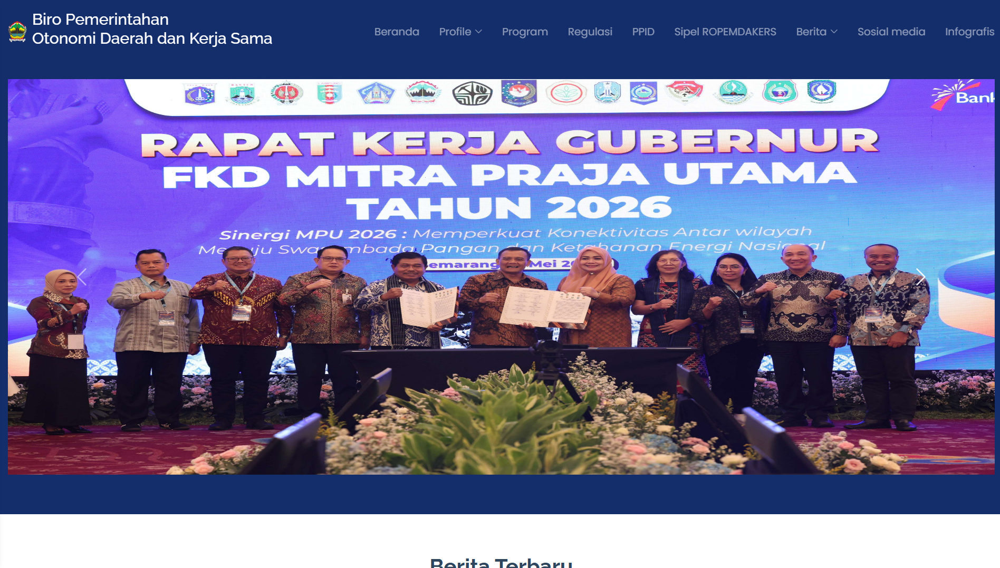
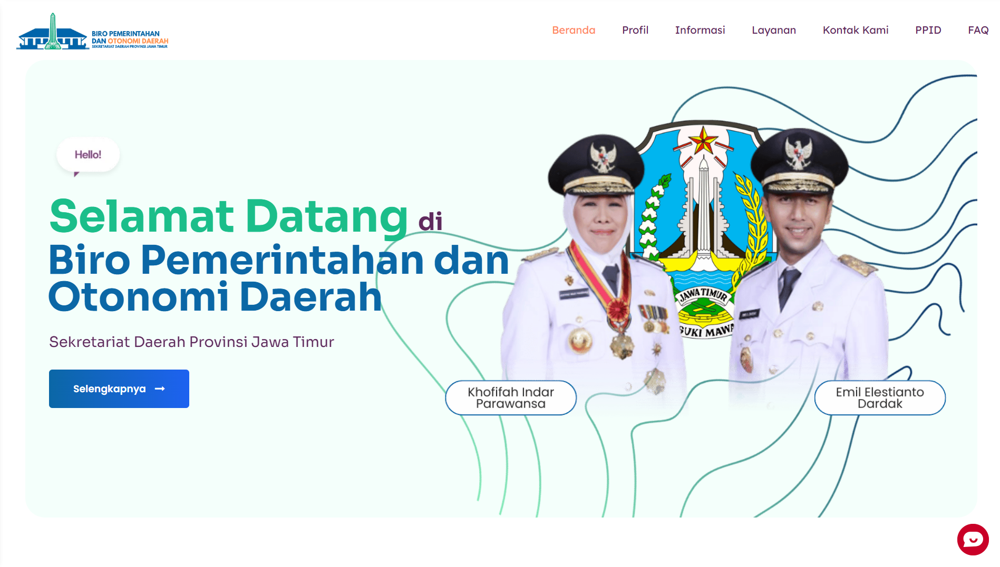

# Benchmarking
## Website yang Dibandingkan

### Website Target: [Biro Pemerintahan Otonomi Daerah dan Kerja Sama Provinsi Jawa Tengah]
- **URL:** (https://biropemotdaks.jatengprov.go.id)
- **Halaman sejenis:** [Website Biro Pemerintahan Otonomi Daerah Provisi Jawa Tengah]
- **Kelebihan:**
  - Tampilan dan alur sederhana yang mudah diterima.
- **Kekurangan:**
  - Isi konten, navigasi dan kualitas pelayanan pengguna yang kurang optimal.
  - Tampilan konten utama yang masih lawas.
  - Kurangnya arahan dan instruksi bantuan jikalau ada masalah.
- **Screenshot:**
  

  ### Website A: [Biropemotda Kepri - Biro Pemerintahan dan Otonomi Daerah Provinsi Kepulauan Riau]
- **URL:** (https://biropemotda.kepriprov.go.id)
- **Halaman sejenis:** [Website Biro Pemerintahan Otonomi Daerah Provisi Kepulauan Riau]
- **Kelebihan:**
  - Tampilan dan fitur yang penuh memudahkan akses.
  - Arah dan alur terstruktur yang membawa kesan profesional.
  - Tampilan responsive yang dinamis pada ukuran layar apapun.
- **Kekurangan:**
  - Tampilan penuh dan kompleks dapat membingungkan pengguna baru.
- **Screenshot:**
  

### Website B: [Biro Pemerintahan dan Otonomi Daerah Setda Provinsi Jawa Timur]
- **URL:** (https://ropem.jatimprov.go.id)
- **Halaman sejenis:** [Website Biro Pemerintahan Otonomi Daerah Provisi Jawa Timur]
- **Kelebihan:**
  - Tampilan baharu dan konsisten yang memanjakan mata.
  - Arah dan alur terstruktur yang membawa kesan profesional.
  - Navigasi laman sangat mudah dan tidak membingungkan.
- **Kekurangan:**
  - Kurangnya kapabilitas tampilan responsive.
- **Screenshot:**
  

## Perbandingan Fitur

| Fitur | Website Target | Website A | Website B | Desain Ulang Kami |
|---|---|---|---|---|
| Quick-link | ❌ Tidak ada | ✅ Ada | ✅ Ada | ✅ Ada |
| File Download | ✅ Ada | ✅ Ada | ✅ Ada | ✅ Ada |
| Navigation Bar | ✅ Ada | ✅ Ada | ✅ Ada | ✅ Ada |
| Global Search | ❌ Tidak ada | ✅ Ada | ❌ Tidak ada | ❌ Tidak ada |
| Pop-up | ⚠️ Sebagian | ✅ Ada | ❌ Tidak ada | ❌ Tidak ada |
| Carausel & Animation | ❌ Tidak ada | ✅ Ada | ✅ Ada(Sebagian) | ✅ Ada(Sebagian) |

## Pelajaran dari Benchmarking:
1. [Insight 1 — Tampilan minimalis dan konsisten UI]
2. [Insight 2 — Kompleksitas berlebih yang tidak perluh]
3. [Insight 3 — Kesempatan untuk menjadi berbeda dengan pendekatan tersendiri melalui implementasi]